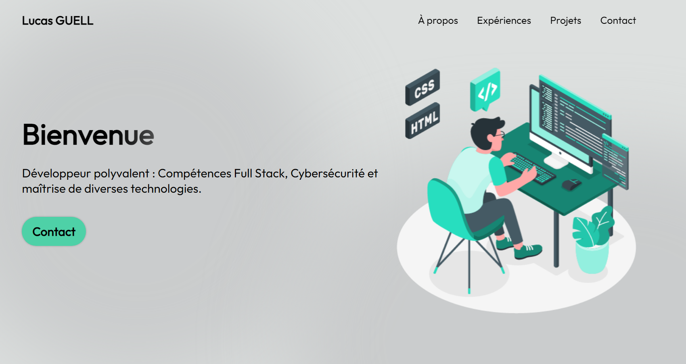

# LePortfolio2023

Portfolio web personnel de 2023, statique et responsive, développé avec React, CSS Modules et Vite.

[](https://react.dev/)
[](https://developer.mozilla.org/docs/Web/JavaScript)
[](https://vite.dev/)
[](https://github.com/css-modules/css-modules)
[](https://github.com/mattboldt/typed.js)
[](https://eslint.org/)
[](LICENCE)

Version en ligne : [lucasguell.com/Projects/LePortfolio2023](https://lucasguell.com/Projects/LePortfolio2023/)



## Fonctionnalités

- **Terminal animé** : la section À propos affiche un faux terminal dans lequel du code React s'écrit et s'efface en boucle, avec coloration syntaxique (Typed.js).
- **Compétences et parcours** : générés à partir d'un fichier JSON, avec un logo par technologie et par établissement.
- **Cartes de projets** : image, description, technologies utilisées et lien vers le code source.
- **Navigation** : barre de navigation avec menu rétractable sur mobile.
- **Responsive** : mise en page adaptée du mobile au grand écran.
- **Contenu séparé du code** : l'ensemble des textes est stocké dans un fichier JSON par section (voir [Modification du contenu](#modification-du-contenu)).

## Sections

| Section | Contenu |
|---|---|
| Accueil | Présentation et bouton de contact |
| À propos | Terminal animé et spécialisations (Frontend, Backend, UI/UX) |
| Expériences | Compétences techniques et parcours de formation |
| Projets | Réalisations avec technologies et liens vers le code source |
| Contact | Email et GitHub |

## Stack technique

| Domaine | Outils |
|---|---|
| Interface | [React 19](https://react.dev/), JavaScript (JSX) |
| Style | CSS Modules, variables CSS, polices [Outfit et Roboto](https://fontsource.org/) |
| Animation | [Typed.js](https://github.com/mattboldt/typed.js) |
| Compilation | [Vite 8](https://vite.dev/) |
| Qualité du code | [ESLint 10](https://eslint.org/), règles React Hooks |

## Installation

Prérequis : [Node.js](https://nodejs.org/) 20.19 ou plus récent (ou 22.12+).

```bash
git clone https://github.com/Luckickio/LePortfolio2023.git
cd LePortfolio2023
npm install
npm run dev
```

Le serveur de développement est accessible sur http://localhost:5173.

### Scripts

| Commande | Rôle |
|---|---|
| `npm run dev` | Serveur de développement avec rechargement à chaud |
| `npm run build` | Compilation du site dans `dist/` |
| `npm run preview` | Service local du dossier `dist/` pour tester la version compilée |
| `npm run lint` | Analyse du code avec ESLint |

Remarque : ouvrir `dist/index.html` directement depuis le disque affiche une page blanche, car les navigateurs bloquent les scripts chargés depuis un fichier local. La version compilée doit être servie par `npm run preview` ou par un hébergeur.

## Structure du projet

```
├── index.html               # Page HTML de base (titre, favicon)
├── assets/                  # Images du site, rangées par section
│   ├── about/  contact/  hero/  nav/
│   ├── history/             #   logos des établissements
│   ├── projects/            #   captures d'écran des projets
│   └── skills/              #   logos des technologies
└── src/
    ├── main.jsx             # Point d'entrée (polices incluses)
    ├── App.jsx              # Assemblage des sections
    ├── index.css, vars.css  # Styles globaux et variables (couleurs, polices)
    ├── utils.js             # getImageUrl : résolution des images de assets/
    ├── components/          # Une section par dossier (composant + CSS Module)
    └── data/                # Textes du site, un fichier par section
        ├── navbar.json
        ├── hero.json
        ├── about.json
        ├── terminal.json
        ├── experience.json
        ├── projects.json
        └── contact.json
```

## Modification du contenu

Les textes ne sont pas écrits dans les composants : chaque section lit son propre fichier JSON dans [`src/data/`](src/data/).

| Fichier | Section | Contenu |
|---|---|---|
| `navbar.json` | Navigation | Nom affiché et liens du menu |
| `hero.json` | Accueil | Titre, description, bouton de contact et image |
| `about.json` | À propos | Titre et spécialisations |
| `terminal.json` | Terminal (dans À propos) | Message affiché par le code animé |
| `experience.json` | Expériences | Titre, compétences et parcours |
| `projects.json` | Projets | Titre, libellé du lien source et liste des projets |
| `contact.json` | Contact | Titre, phrase d'accroche et liens |

Modifier un texte, ajouter une compétence ou un projet ne demande donc qu'une modification du fichier de la section concernée.

Les images se placent dans `assets/`, dans le sous-dossier de la section concernée. Dans les fichiers JSON, leur chemin s'écrit à partir de ce dossier, par exemple `"skills/react.png"` ou `"projects/GCR.png"`.

## Contact

- Email : [contact@lucasguell.com](mailto:contact@lucasguell.com)
- GitHub : [github.com/Luckickio](https://github.com/Luckickio)
- LinkedIn : [linkedin.com/in/lucasguell](https://linkedin.com/in/lucasguell)

## Licence

Code source distribué sous licence [MIT](LICENCE).

© 2023 Lucas GUELL
